 

<a href="https://angelosolis.dev"><picture><source media="(prefers-color-scheme: dark)" srcset="https://raw.githubusercontent.com/angelosolis/angelosolis/main/assets/link-web-dark.svg" /></picture></a>
<a href="https://x.com/SolisAngeloM"><picture><source media="(prefers-color-scheme: dark)" srcset="https://raw.githubusercontent.com/angelosolis/angelosolis/main/assets/link-x-dark.svg" /></picture></a>
<a href="https://www.facebook.com/SolisAngeloM/"><picture><source media="(prefers-color-scheme: dark)" srcset="https://raw.githubusercontent.com/angelosolis/angelosolis/main/assets/link-fb-dark.svg" /></picture></a>

 

<picture><source media="(prefers-color-scheme: dark)" srcset="https://raw.githubusercontent.com/angelosolis/angelosolis/main/assets/stack-dark.svg" /></picture>

  

  

<picture>
  <source media="(prefers-color-scheme: dark)" srcset="https://streak-stats.demolab.com?user=angelosolis&hide_border=true&border_radius=14&background=141413&ring=D97757&fire=D97757&currStreakNum=E8E6DC&sideNums=E8E6DC&currStreakLabel=D97757&sideLabels=E8E6DC&dates=6B6960&stroke=2E2D2A" />
  
</picture>

  

<picture>
  <source media="(prefers-color-scheme: dark)" srcset="https://raw.githubusercontent.com/angelosolis/angelosolis/output/snake-dark.svg" />
  
</picture>

