  

&nbsp;
&nbsp;

  

<b>DAILY DRIVERS</b>
 

  

<picture>
  <source media="(prefers-color-scheme: dark)" srcset="https://streak-stats.demolab.com?user=angelosolis&hide_border=true&border_radius=14&background=0D1117&ring=A78BFA&fire=F472B6&currStreakNum=FFFFFF&sideNums=FFFFFF&currStreakLabel=22D3EE&sideLabels=C9D1D9&dates=6E7681&stroke=30363D" />
  
</picture>

  

<picture>
  <source media="(prefers-color-scheme: dark)" srcset="https://raw.githubusercontent.com/angelosolis/angelosolis/output/snake-dark.svg" />
  
</picture>

